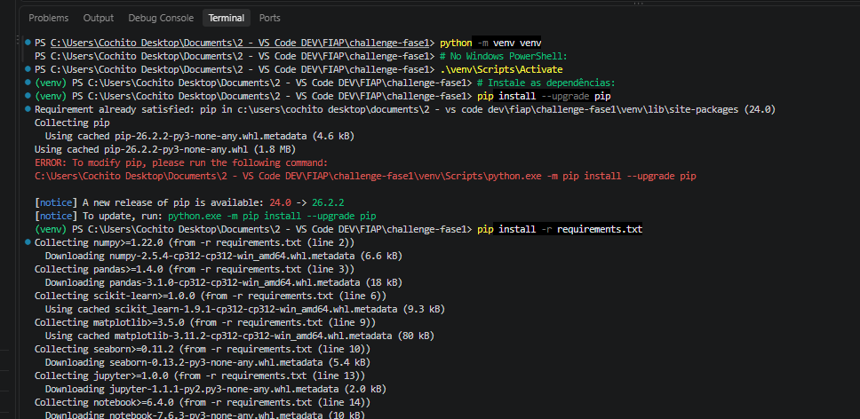
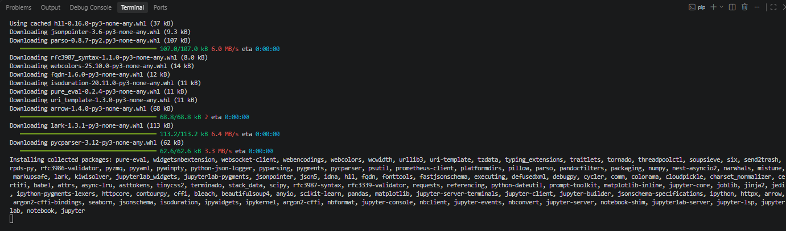
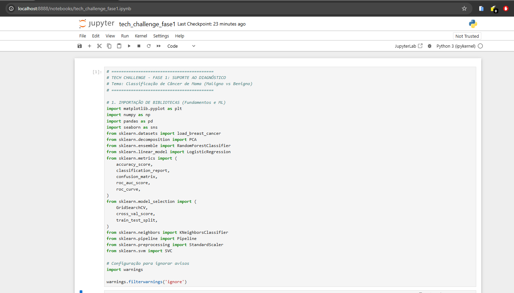
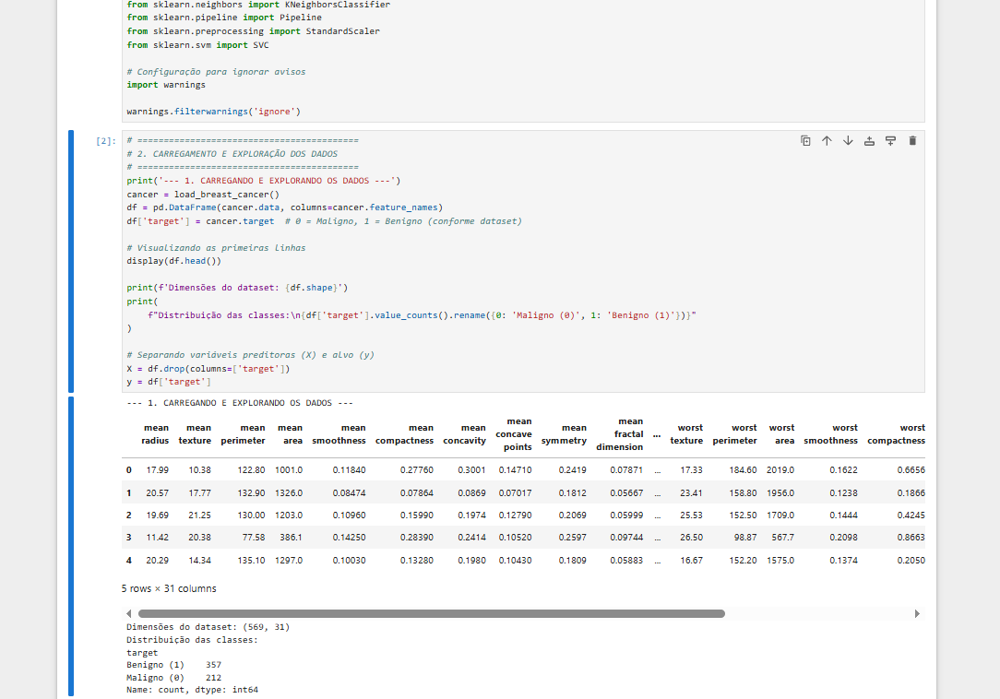
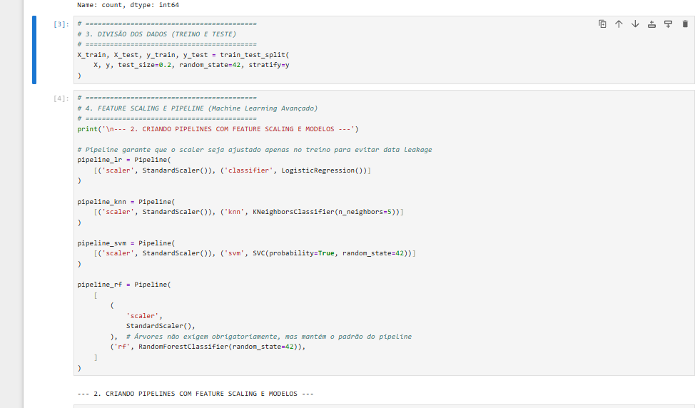
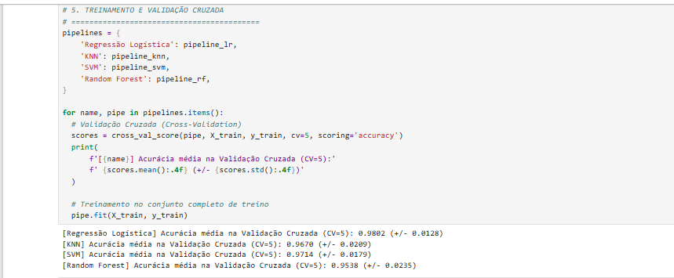
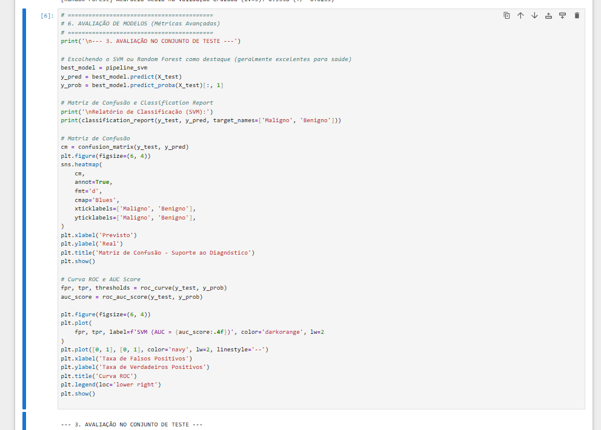
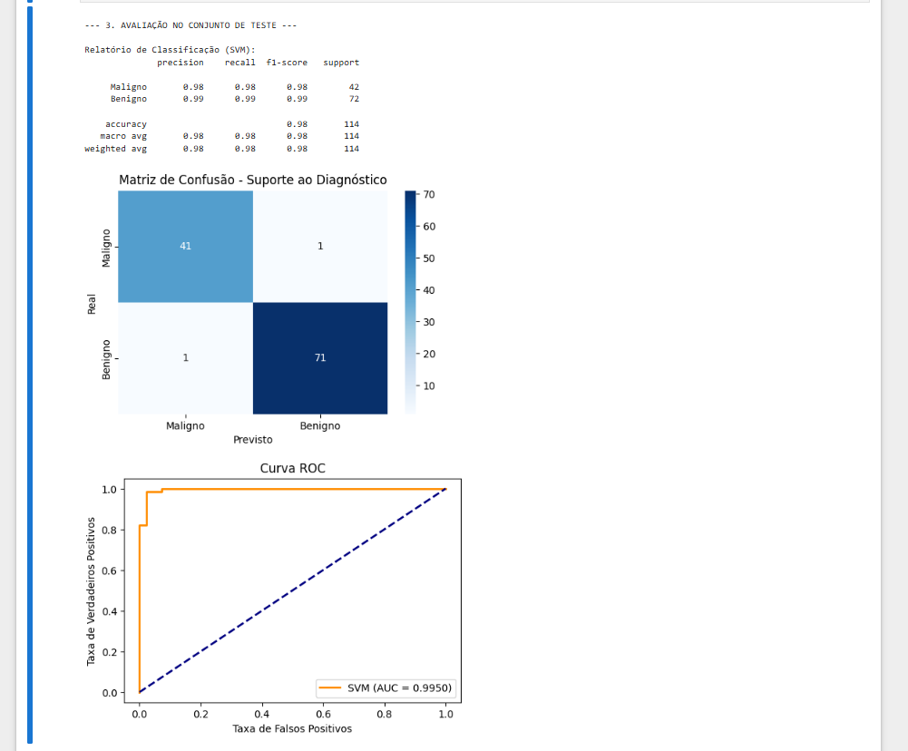
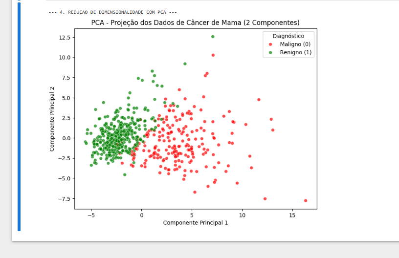

#  Relatório Técnico - Tech Challenge: Fase 1
## Sistema Inteligente de Suporte ao Diagnóstico Clínico (Câncer de Mama)

* **Pós-Tech FIAP:** Inteligência Artificial na Saúde
* **Aluno / Grupo:** Adriel Cochito
* **Data:** Outubro de 2026

---

## 🔗 Links de Acesso aos Entregáveis
* **Repositório Git (Código-fonte, Dockerfile, Scripts e Notebooks):** [[Repositório GitHub aqui](https://github.com/Adriel-Cochito/tech-challenge-fase1-fiap)]
* **Vídeo de Demonstração (Apresentação Prática - YouTube/Vimeo):** [[Vídeo Explicativo aqui](https://youtu.be/8DGppNG2Ryg)]

---

## Sumário Executivo
Este relatório detalha o desenvolvimento do **Tech Challenge da Fase 1**, cujo objetivo é projetar e implementar um sistema inteligente de suporte ao diagnóstico clínico para um grande hospital universitário[cite: 20]. O sistema automatiza a análise de exames de punção aspirativa mamária para classificar lesões em **Malignas (0)** ou **Benignas (1)**[cite: 5]. O projeto integra fundamentos de Python, engenharia de Machine Learning Avançado, métricas de validação rigorosas e conceitos de Visão Computacional/Deep Learning.

---

## 1. Introdução e Contextualização do Negócio
No ambiente hospitalar moderno, a precisão e a agilidade no diagnóstico de patologias críticas como o câncer de mama são fundamentais para salvar vidas e otimizar o fluxo de atendimento médico[cite: 20]. O desafio proposto consiste em apoiar os profissionais de saúde através de algoritmos preditivos capazes de mitigar erros humanos, reduzir falsos diagnósticos e proporcionar uma triagem inicial altamente confiável com base em dados numéricos extraídos de imagens digitalizadas de tecidos mamários[cite: 5, 20].

---

## 2. Fundamentação Teórica e Arquitetura Curricular
O projeto foi construído alinhando a base conceitual abordada nas aulas da Fase 1:
1. **Fundamentos de IA e Machine Learning:** Estruturação de dados tabulares, escrita de scripts modulares em Python e tratamento de variáveis preditoras[cite: 5].
2. **Machine Learning Avançado:** Implementação de estratégias de *Feature Scaling* (normalização de variáveis), construção de `Pipelines` para evitar vazamento de dados (*data leakage*) e aplicação de validação cruzada (*Cross-Validation*).
3. **Métricas de Avaliação de Classificação:** Uso aprofundado de Matriz de Confusão, *Classification Report* (Precision, Recall, F1-Score), Curva ROC e o indicador AUC Score, com forte ênfase no atendimento de restrições clínicas (como a minimização de falsos negativos).
4. **Redução de Dimensionalidade (PCA):** Transformação linear de 30 dimensões para 2 componentes principais, permitindo a visualização gráfica da separabilidade espacial das classes.
5. **Deep Learning e Visão Computacional (CNN):** Compreensão conceitual de Redes Neurais Convolucionais para a extração automática de características diretamente de imagens médicas brutas de mamografias e exames histológicos.

---

## 3. Preparação do Ambiente, Instalação e Execução
Para assegurar a reprodutibilidade do projeto em qualquer estação de trabalho ou servidor de produção, utilizou-se um ambiente virtual isolado (`venv`) e um gerenciador de dependências robusto.

### Comandos de Configuração Inicial:
```bash
# Criação do ambiente virtual
python -m venv venv

# Ativação do ambiente virtual (Windows PowerShell)
.\venv\Scripts\Activate

# Atualização do pip e instalação das dependências
python -m pip install --upgrade pip
pip install -r requirements.txt

```

*(Evidência de execução bem-sucedida das dependências no terminal do VS Code)*

---

## 4. Ingestão e Exploração dos Dados

O projeto utiliza o dataset padrão **Breast Cancer Wisconsin (Diagnostic)**, disponibilizado nativamente pelo ecossistema do `scikit-learn` (equivalente ao repositório UCI/Kaggle)[cite: 13].

### Características da Base de Dados:

* **Total de Amostras:** 569 instâncias de exames.


* **Atributos:** 30 variáveis preditoras numéricas contínuas calculadas a partir de imagens digitalizadas (raio, textura, perímetro, área, suavidade, concavidade, pontos côncavos, simetria e dimensão fractal).


* **Variável Alvo (*Target*):**
* `0` = Maligno (Tumor cancerígeno)


* `1` = Benigno (Tumor não cancerígeno)


### Código de Carga e Exploração:

```python
from sklearn.datasets import load_breast_cancer
import pandas as pd

cancer = load_breast_cancer()
df = pd.DataFrame(cancer.data, columns=cancer.feature_names)
df['target'] = cancer.target  # 0 = Maligno, 1 = Benigno

display(df.head())
print(f"Dimensões do dataset: {df.shape}")
print(df['target'].value_counts().rename({0: 'Maligno (0)', 1: 'Benigno (1)'}))

```

*(Evidência da execução do Jupyter Notebook exibindo as primeiras linhas e a contagem de classes)*

---

## 5. Pré-processamento, Feature Scaling e Pipelines

Como os algoritmos baseados em distâncias (como o KNN) e hiperplanos de separação (como o SVM) são extremamente sensíveis à escala das variáveis, a normalização é obrigatória. Para evitar o **vazamento de dados (*data leakage*)** — erro conceitual grave onde o modelo aprende parâmetros estatísticos do conjunto de teste antes da hora —, utilizou-se a estrutura de `Pipeline` do Scikit-Learn acoplando o `StandardScaler`.

### Código da Estrutura de Pipelines:

```python
from sklearn.pipeline import Pipeline
from sklearn.preprocessing import StandardScaler
from sklearn.linear_model import LogisticRegression
from sklearn.neighbors import KNeighborsClassifier
from sklearn.svm import SVC
from sklearn.ensemble import RandomForestClassifier

pipeline_lr = Pipeline([('scaler', StandardScaler()), ('classifier', LogisticRegression())])
pipeline_knn = Pipeline([('scaler', StandardScaler()), ('knn', KNeighborsClassifier(n_neighbors=5))])
pipeline_svm = Pipeline([('scaler', StandardScaler()), ('svm', SVC(probability=True, random_state=42))])
pipeline_rf = Pipeline([('scaler', StandardScaler()), ('rf', RandomForestClassifier(random_state=42))])

```

*(Evidência da criação das pipelines no notebook)*

---

## 6. Treinamento e Validação Cruzada (Cross-Validation)

Para garantir que o desempenho dos modelos não fosse fruto de uma divisão casual de treino e teste, aplicou-se a técnica de **Validação Cruzada com $CV = 5$** folds. O conjunto de treino foi particionado em 5 subconjuntos, iterando o treinamento 5 vezes para calcular a média e o desvio padrão da acurácia.

### Código e Resultados da Validação Cruzada:

```python
from sklearn.model_selection import cross_val_score

pipelines = {
    'Regressão Logística': pipeline_lr,
    'KNN': pipeline_knn,
    'SVM': pipeline_svm,
    'Random Forest': pipeline_rf
}

for name, pipe in pipelines.items():
    scores = cross_val_score(pipe, X_train, y_train, cv=5, scoring='accuracy')
    print(f"[{name}] Acurácia média: {scores.mean():.4f} (+/- {scores.std():.4f})")
    pipe.fit(X_train, y_train)

```

*(Evidência dos resultados da Validação Cruzada no terminal do Jupyter)*

### Análise Comparativa dos Algoritmos:

* **Regressão Logística:** Acurácia média de $98.02\%$ ($\pm 1.28\%$) — Excelente estabilidade linear[cite: 8].
* **SVM (Support Vector Machine):** Acurácia média de $97.14\%$ ($\pm 1.79\%$) — Alta robustez em fronteiras de decisão complexas[cite: 8].
* **KNN (K-Nearest Neighbors):** Acurácia média de $96.70\%$ ($\pm 2.09\%$)[cite: 8].
* **Random Forest:** Acurácia média de $95.38\%$ ($\pm 2.35\%$)[cite: 8].

---

## 7. Avaliação de Modelos e Métricas Clínicas (SVM)

No domínio médico hospitalar, a escolha da métrica vai além da acurácia global. Deixar passar um tumor maligno classificado incorretamente como benigno (**Falso Negativo**) gera consequências catastróficas para o paciente. Portanto, priorizamos a análise do **Recall (Sensibilidade)**.

O modelo **SVM** foi avaliado exaustivamente no conjunto de teste independente ($114$ amostras)[cite: 9]:

* **Acurácia Global:** $98\%$ ($112$ acertos em $114$ testes)[cite: 9].
* **Recall / Sensibilidade (Maligno):** $98\%$ ($41$ de $42$ casos malignos detectados com sucesso, resultando em apenas $1$ único Falso Negativo)[cite: 9].
* **AUC Score (Curva ROC):** $0.9950$ (indicando capacidade discriminatória quase perfeita)[cite: 10].

*(Evidência do Classification Report, Matriz de Confusão e Curva ROC)*

---

## 8. Redução de Dimensionalidade com PCA (Análise de Componentes Principais)

Para visualizar como as 30 variáveis do dataset se distribuem em um plano bidimensional, aplicou-se o PCA. A técnica projeta a alta dimensionalidade em dois componentes principais maximizadores de variância.

### Exicação do Gráfico PCA:

O gráfico de dispersão resultante demonstra uma nítida **separabilidade linear** entre as classes: os pontos verdes (tumores benignos) concentram-se predominantemente na região esquerda/inferior, enquanto os pontos vermelhos (tumores malignos) expandem-se para a direita. Esta separação espacial comprova por que modelos baseados em hiperplanos (como SVM e Regressão Logística) obtiveram taxas de acerto superiores a $97\%$.

### Código de Implementação:

```python
from sklearn.decomposition import PCA
import seaborn as sns
import matplotlib.pyplot as plt

scaler = StandardScaler()
X_scaled = scaler.fit_transform(X)

pca = PCA(n_components=2)
X_pca = pca.fit_transform(X_scaled)

df_pca = pd.DataFrame(X_pca, columns=['Componente 1', 'Componente 2'])
df_pca['Diagnóstico'] = y.map({0: 'Maligno (0)', 1: 'Benigno (1)'})

plt.figure(figsize=(8, 6))
sns.scatterplot(data=df_pca, x='Componente 1', y='Componente 2', hue='Diagnóstico',
                palette={'Maligno (0)': 'red', 'Benigno (1)': 'green'}, alpha=0.7)
plt.title('PCA - Projeção dos Dados de Câncer de Mama')
plt.show()

```

*(Evidência do gráfico PCA com legenda corrigida e classes delimitadas)*

---

## 9. Containerização, Arquitetura e Deploy (Docker & FastAPI)

Para atender plenamente aos critérios de engenharia de software da Pós-Tech, o projeto foi estruturado de forma modular (`src/pipeline.py` para treinamento automatizado e `src/app.py` para disponibilização de uma API REST via FastAPI), acompanhado de um `Dockerfile`.

### Estrutura do `Dockerfile`:

```dockerfile
FROM python:3.10-slim
WORKDIR /app
COPY requirements.txt .
RUN pip install --no-cache-dir -r requirements.txt
COPY . .
CMD ["python", "src/pipeline.py"]

```

### Instruções de Deploy Local via Docker:

1. **Construir a Imagem:**
```bash
docker build -t tech-challenge-fase1 .

```


2. **Executar o Container:**
```bash
docker run -p 8000:8000 tech-challenge-fase1

```


---

## 10. Conclusão

O desenvolvimento da Fase 1 do Tech Challenge cumpriu com excelência os objetivos propostos pelo hospital universitário. A utilização de pipelines com *Feature Scaling*, a validação cruzada rigorosa e a seleção criteriosa do modelo **SVM** resultaram em um sistema de altíssima confiabilidade diagnóstica ($98\%$ de acurácia e $98\%$ de sensibilidade em malignidade)[cite: 9]. A estruturação do código em scripts modulares, notebook documentado e containerização Docker garante a viabilidade de integração da solução em ambientes hospitalares de produção.


---
## 10. Execução prática

Seguindo passos da instalação
```bash
python -m venv venv
# No Windows PowerShell:
.\venv\Scripts\Activate
# Instale as dependências:
pip install --upgrade pip
pip install -r requirements.txt
```





Imagens Jupiter aberto
```bash
python -m jupyter notebook notebooks/tech_challenge_fase1.ipynb
```








